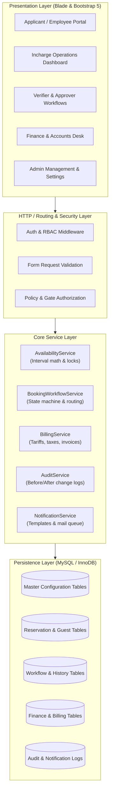
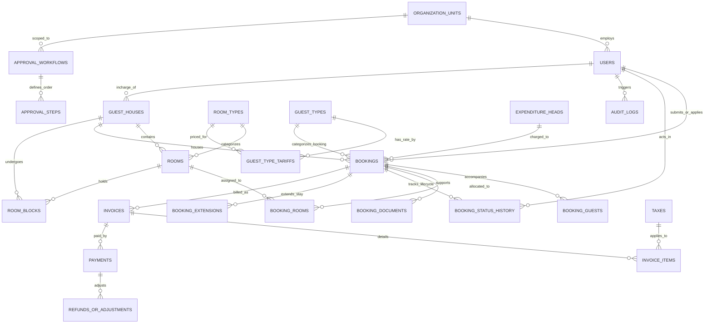
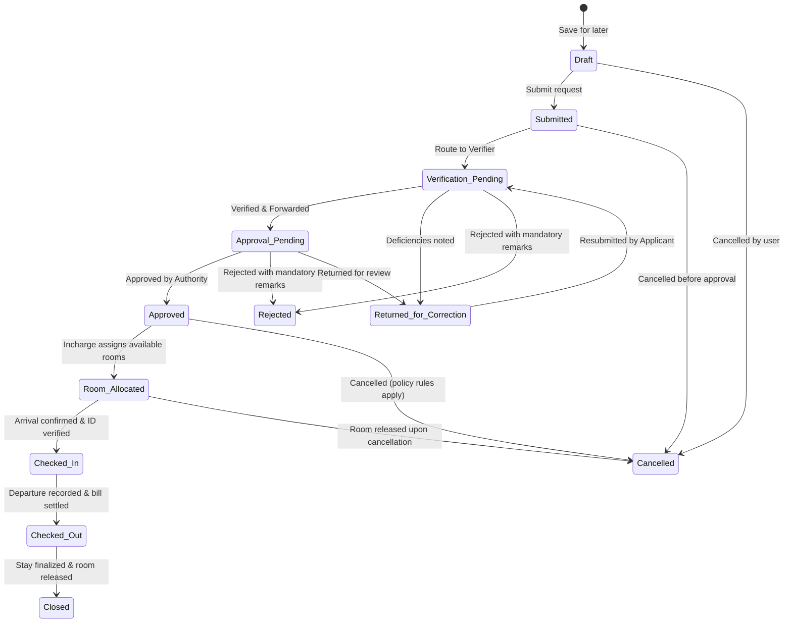

# University Guest House Management System (UGHMS)
## Master Architecture & Entity-Relationship Design (Phase 1)

**Target Institution:** Dr. Y.S. Parmar University of Horticulture & Forestry, Nauni, Solan (H.P.)  
**Document Reference:** UGHMS Master Implementation Manual v1.0  
**Technology Stack:** Laravel 10/11 (PHP 8.1+), MySQL/MariaDB (InnoDB, utf8mb4), Blade, Bootstrap 5, Vanilla JS, CSS3.

---

### 1. Architectural Overview

The University Guest House Management System is structured around a domain-driven, service-oriented monolithic Laravel architecture. It cleanly separates:
- **Presentation Layer (Blade + Bootstrap 5):** University-branded, responsive, accessible UI with role-specific dashboards, modals for remarks, timeline-based status indicators, and print-ready vouchers.
- **Controller & Routing Layer:** RESTful, resource-oriented routing with CSRF protection, request throttling, and policy-based authorization checks at every endpoint.
- **Domain Service Layer:** Isolated business logic for:
  - `AvailabilityService`: Interval `[check_in, check_out)` availability computation, capacity checks, room block integration, and concurrency protection.
  - `BookingWorkflowService`: State machine transitions, mandatory remarks recording, approver routing, and historical timeline generation.
  - `BillingService`: Category-based tariffs, billable night calculation, tax addition, payment stage enforcement, and immutable invoice generation.
  - `AuditService`: Immutable change capture with actor ID, IP address, and before/after JSON states.
  - `NotificationService`: Queue-friendly email dispatch with templating and delivery failure resilience.
- **Persistence Layer (Eloquent ORM & Migrations):** Fully normalized InnoDB database schema with foreign keys, compound indexes, soft deactivation, and decimal-safe monetary columns (`DECIMAL(10,2)`).

---

### 2. Entity-Relationship Diagram (ERD)

---

### 3. Booking State Machine

---

### 4. Database Table Dictionary

1. **`organization_units`**: Departments, Colleges (e.g. College of Horticulture, College of Forestry, Directorate of Research), Administrative offices.
2. **`users`**: System actors with role assignments, employee IDs, designations, contact numbers, and org unit links.
3. **`roles` & `permissions`**: RBAC permissions matrix covering system administration, guest house administration, incharge duty, verification, approval, finance, and auditing.
4. **`guest_houses`**: Property master (VIP Guest House, Faculty Guest House, Farmers Hostel / Kisan Bhawan) with capacity, address, assigned incharge, publication status (`draft`/`published`), eligibility rules, and contact info.
5. **`room_types`**: Standard Single, Standard Double, Deluxe Suite, VIP Suite, Executive AC, Non-AC Dormitory.
6. **`rooms`**: Specific physical rooms with room number, floor, room type, custom tariff override if any, max occupancy, amenities/facilities, active status, and maintenance status.
7. **`guest_types`**: Official University Guest, Other University / Govt Official, Semi-Official / Conference Participant, Personal / Private Guest.
8. **`guest_type_tariffs`**: Matrix defining rate per night for each (Guest Type, Room Type) pair.
9. **`taxes`**: Configurable taxes (e.g. CGST 6%, SGST 6%, Exempt).
10. **`expenditure_heads`**: University budget heads (e.g., General University Fund, ICAR Project Plan, Dean Hort, etc.).
11. **`system_settings`**: Global keys (`payment_stage`: `approval`, `check_in`, `check_out`; `check_in_time`: `12:00`; `check_out_time`: `11:00`; `allow_same_day_booking`: `true`, etc.).
12. **`approval_workflows` & `approval_steps`**: Configurable multi-tier routing by service type and org unit.
13. **`bookings`**: Central reservation table capturing unique reference (`UGH-2026-XXXX`), applicant, beneficiary guest, dates, head of account, state, financial aggregates.
14. **`booking_guests`**: Detailed roster of visitors, primary guest designation, accompanying persons, relationships, and ID card reference.
15. **`booking_rooms`**: Allocation records linking booking to specific physical rooms with allocation and deallocation timestamps.
16. **`room_blocks`**: Unavailability periods for cleaning, renovation, VIP block, or maintenance.
17. **`booking_status_history`**: Immutable log of every workflow state change with user, timestamp, previous status, next status, and required remarks.
18. **`booking_extensions`**: Request for extending check-out date, availability re-check, extra charges, and approval trail.
19. **`booking_documents`**: Securely uploaded approval letters, duty letters, and identification cards stored in private storage.
20. **`invoices` & `invoice_items`**: Finalized itemized billing records locking rates, nights, taxes, and incidental charges.
21. **`payments` & `refunds_or_adjustments`**: Financial transaction ledgers with payment mode, receipt number, balance calculation, and audit trail.
22. **`email_templates` & `notification_logs`**: Templates and delivery tracking for all lifecycle events.
23. **`audit_logs`**: Tamper-proof actor activity tracking capturing `table_name`, `record_id`, `before_state`, and `after_state`.

---

### 5. Mathematical & Business Invariants

- **Date Interval Allocation Invariant:**  
  A room $R$ is occupied during stay interval $[S_{start}, S_{end})$ if and only if for any candidate stay $[C_{start}, C_{end})$:  
  $\max(S_{start}, C_{start}) < \min(S_{end}, C_{end})$  
  where departure day $S_{end}$ is not an occupied night (check-out time 11:00 AM, check-in 12:00 PM).
- **Billing Calculation Invariant:**  
  $$\text{Nights} = \max(1, \text{DateDiff}(D_{dep}, D_{arr}))$$  
  $$\text{Room Charges} = \sum_{r \in \text{Rooms}} (\text{Tariff}(G_{type}, R_{type}) \times \text{Nights})$$  
  $$\text{Tax Total} = \sum_{t \in \text{Taxes}} (\text{Room Charges} \times \frac{\text{Rate}_t}{100})$$  
  $$\text{Grand Total} = \text{Room Charges} + \text{Tax Total} + \text{Additions} - \text{Discounts}$$  
  All stored as exact `DECIMAL(10,2)` without floating-point drift.
- **Concurrency Protection Invariant:**  
  Room allocation and status promotion execute inside atomic database transactions (`DB::transaction`) utilizing `SELECT ... FOR UPDATE` row locks on the candidate `rooms` and `bookings` to prevent dual-allocations.

